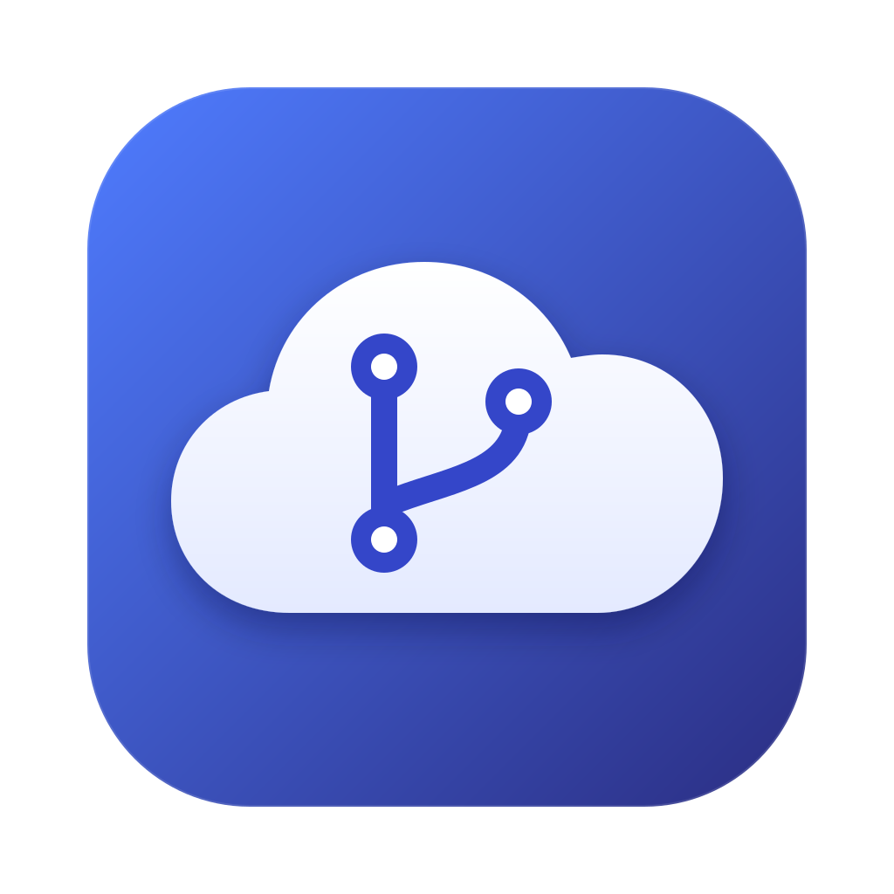
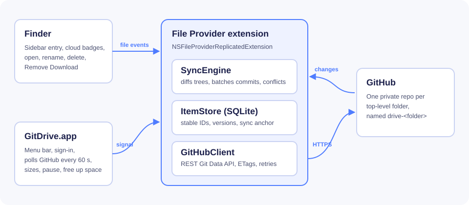

<p align="center">
  
</p>

<h1 align="center">GitDrive</h1>

<p align="center">
  Your private GitHub repos as a drive in Finder. Files download when you open them and can be removed from your Mac without leaving the cloud.
</p>

<p align="center">
  <a href="https://github.com/deeeeone/gitdrive/actions/workflows/ci.yml"></a>
  <a href="https://github.com/deeeeone/gitdrive/releases/latest"></a>
  
  
  <a href="LICENSE"></a>
</p>

<p align="center">
  
</p>

## Features

- **Lives in Finder.** GitDrive appears in the Finder sidebar like iCloud Drive or Dropbox, built on Apple's File Provider framework.
- **Files on demand.** Everything is listed right away. A file downloads only when you open it.
- **Frees up space.** Right-click and choose Remove Download, or use Free Up Space in the menu bar. macOS can also remove downloads on its own when the disk is low.
- **Private by default.** Every top-level folder is its own private GitHub repo named `drive-<folder>`.
- **Real git history.** Each save is a commit, so every old version stays recoverable on GitHub.
- **Works with other edits.** Changes made on github.com or from a clone show up in Finder within a minute. Edits on both sides keep both copies.
- **Menu bar app.** Sync status, folder sizes, pause, launch at login.
- **No local clones.** GitDrive talks to the GitHub API directly, so files are never stored twice.

## How it works

<p align="center">
  
</p>

The File Provider extension serves the drive to Finder. It keeps a small SQLite index of every file and folder, turns your edits into commits through the GitHub Git Data API, and pulls in remote changes by comparing trees. The menu bar app handles sign-in and asks the extension to check for changes every minute.

More detail is in [docs/ARCHITECTURE.md](docs/ARCHITECTURE.md).

## Install

### Download

Prebuilt downloads will be added to [Releases](https://github.com/deeeeone/gitdrive/releases) once builds are signed with a Developer ID and notarized by Apple. macOS only loads File Provider extensions from properly signed apps, so for now please build from source. It takes about two minutes.

### Build from source

Requirements: macOS 14 or later, Xcode 16 or later, and an Apple ID signed in to Xcode (a free account works).

```bash
git clone https://github.com/deeeeone/gitdrive.git
cd gitdrive
brew install xcodegen
cp Config/Local.xcconfig.example Config/Local.xcconfig
```

Edit `Config/Local.xcconfig`: set `DEVELOPMENT_TEAM` to your team ID and `GITDRIVE_BUNDLE_ID` to a reverse-DNS name you own. Then:

```bash
xcodegen generate
open GitDrive.xcodeproj
```

Choose the **GitDrive** scheme and press Run.

## First run

1. Click the cloud icon in the menu bar.
2. Sign in. Choose **Sign in with GitHub** (if the build has an OAuth Client ID), or paste a [personal access token](https://github.com/settings/tokens/new?scopes=repo&description=GitDrive) with the `repo` scope.
3. If macOS asks, turn on GitDrive in **System Settings → General → Login Items & Extensions → File Providers**.
4. Click **Open in Finder**. Make a folder at the top level and GitDrive creates a private repo for it.

Already have repos you want in the drive? Open **Settings → Folders → Your other repos** and choose **Add to Drive**.

## Limits and fair use

GitHub is built for source code, not as a general file host, so keep these in mind:

| Limit | What happens |
|---|---|
| 100 MB per file | Larger files are refused with a clear error. Git LFS support is on the roadmap. |
| Repo size | GitHub recommends repos under 1 GB and strongly recommends under 5 GB. The menu bar warns past 1 GB. |
| History | Deleted files still count toward repo size. **Settings → Folders → Compact History** keeps only the current files. |
| API rate limit | 5,000 requests per hour. GitDrive uses conditional requests and backs off when it gets close. |
| Top level | Each top-level item is a repo, so files go inside a folder, not at the very top. |

Please read GitHub's [Acceptable Use Policies](https://docs.github.com/en/site-policy/acceptable-use-policies/github-acceptable-use-policies) before storing large amounts of non-code data.

## Privacy and security

- Your GitHub token is stored only in the macOS Keychain, shared between the app and its extension.
- Repos GitDrive creates are always private.
- GitDrive never deletes a repo. Removing a top-level folder archives the repo instead.
- The only force-push is Compact History, which asks first.
- No analytics, no telemetry, no servers other than GitHub.

Found a security problem? See [SECURITY.md](SECURITY.md).

## Roadmap

- [ ] Git LFS for files over 100 MB
- [ ] Modification dates stored in the repo
- [ ] Moving folders between top-level folders
- [ ] Shared folders (repos you collaborate on)
- [ ] Signed and notarized release builds

## FAQ

**Does it work offline?** Downloaded files open and save as usual. GitDrive uploads your changes when you are back online.

**Can I use the repos with normal git?** Yes. They are ordinary repos. Clone them, push to them, and GitDrive picks up the changes.

**What happens if I uninstall?** Nothing on GitHub changes. Sign out first to remove the downloaded copies from your Mac.

**Why one repo per folder?** It keeps each repo small, lets you share or archive folders separately, and keeps the API traffic for one folder independent of the others.

## Contributing

Contributions are welcome. Read [CONTRIBUTING.md](CONTRIBUTING.md) for setup, code style and how to run the tests. Please follow the [Code of Conduct](CODE_OF_CONDUCT.md).

## License

GitDrive is released under the [MIT License](LICENSE).

## Acknowledgements

- [GRDB.swift](https://github.com/groue/GRDB.swift) for SQLite
- [XcodeGen](https://github.com/yonaskolb/XcodeGen) for the project file
- Apple's [File Provider](https://developer.apple.com/documentation/fileprovider) framework
